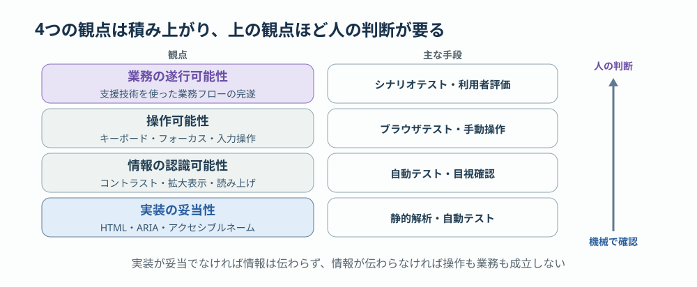
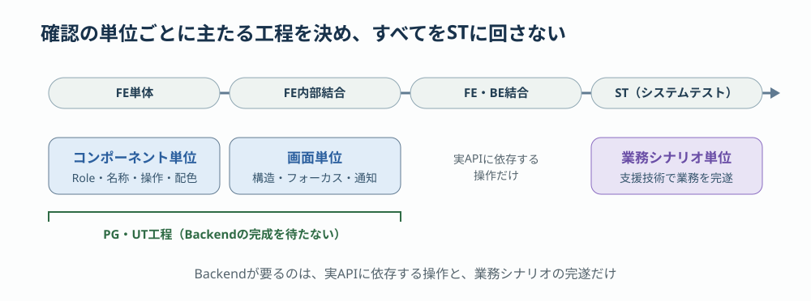
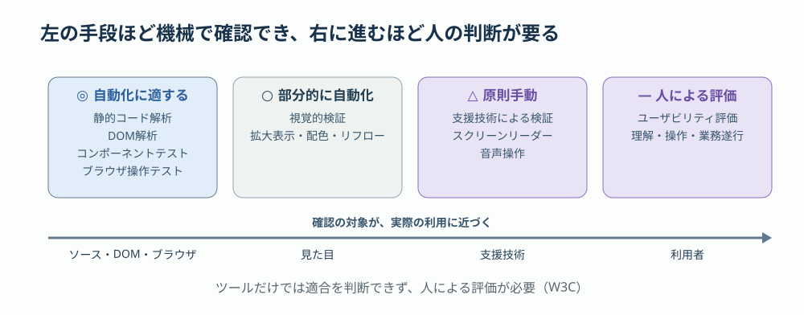
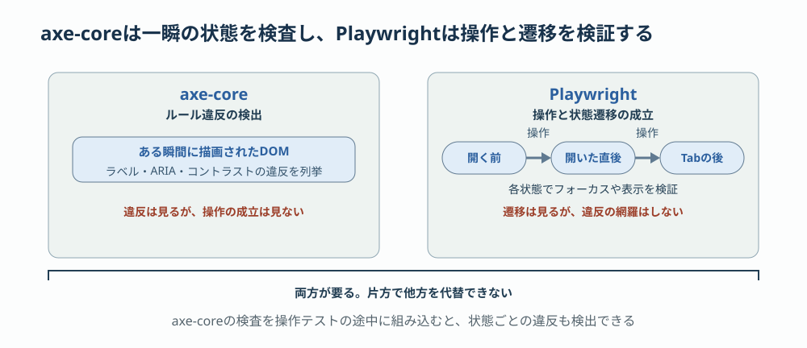
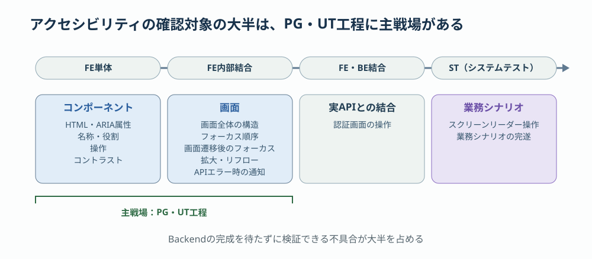
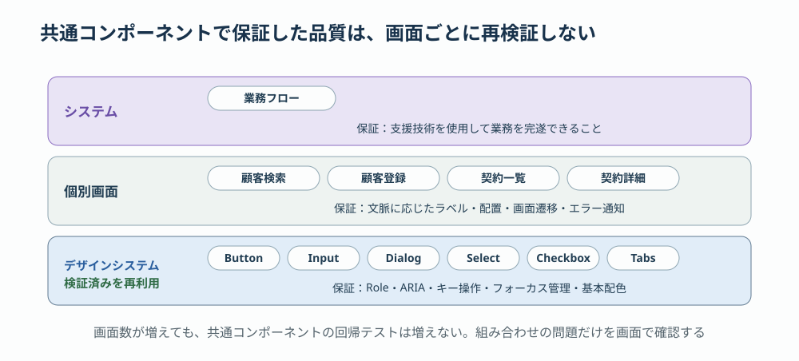
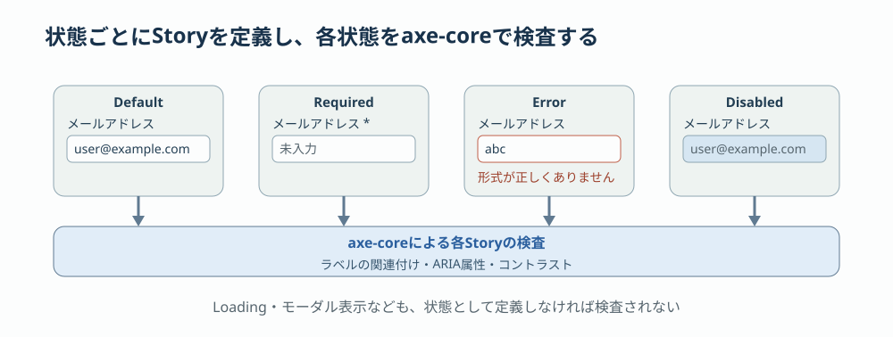
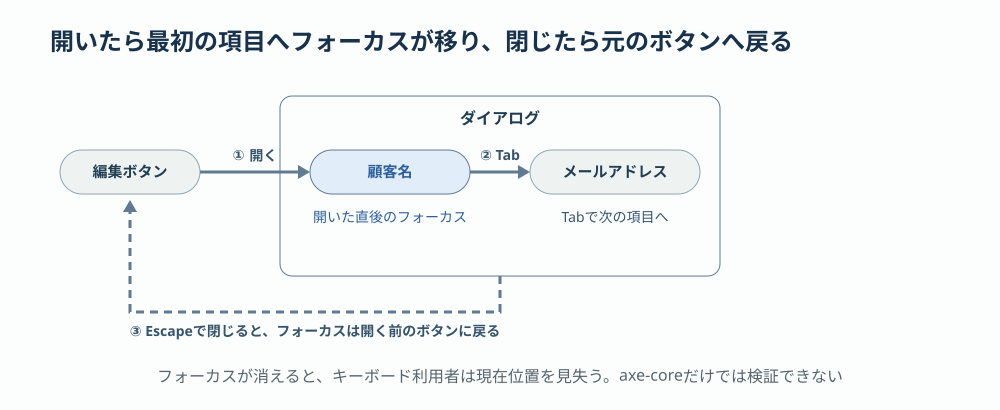
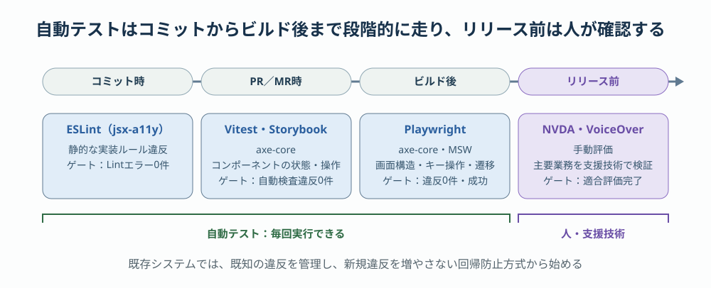
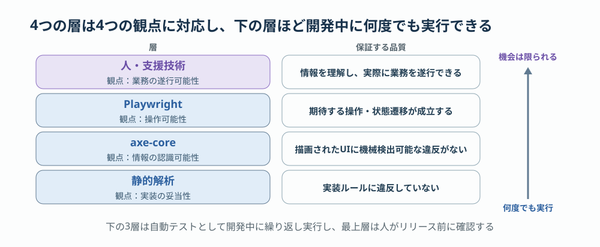

# React／Frontendにおけるアクセシビリティテストの整理

**アクセシビリティテストは、静的解析・axe-core・Playwright・人と支援技術の4層で標準化し、共通コンポーネントが備える品質特性として開発中に継続的に保証する。後工程の検査項目にはしない。**

## 1. アクセシビリティテストは何を検証するのか

アクセシビリティテストは、単にHTMLやARIA属性が正しく記述されているかを確認するものではありません。ARIAは、HTMLだけでは伝わらない要素の役割・名称・状態を、スクリーンリーダーなどの支援技術に伝えるための属性群です。

**実装の妥当性、情報の認識可能性、操作可能性、業務の遂行可能性**という4つの観点から検証する必要があります。



実装の妥当性は、HTML・ARIA・アクセシブルネーム（支援技術が要素を指すときの名前。ラベルや代替テキストから決まる）が正しいかを、静的解析と自動テストでほぼ機械的に確認できます。情報の認識可能性（コントラスト・拡大表示・読み上げ）と操作可能性（キーボード・フォーカス・入力操作）は、自動テストに目視やブラウザ操作を組み合わせます。業務の遂行可能性は、支援技術を使って業務フローを完遂できるかであり、シナリオテストと利用者の評価が要ります。

4つの観点は積み上げの関係にあります。実装が妥当でなければ情報は正しく伝わらず、情報が伝わらなければ操作も業務も成立しません。

## 2. 検証の単位と工程の前提

機能テストと同じく、アクセシビリティもコンポーネント単位、画面単位、業務シナリオ単位に分けて検証します。すべてをシステムテスト工程で検証する必要はありません。

本記事では、Frontendのテスト工程を次の4段階に分けて扱います。この区分は、Frontendの単体テストと結合テストの境界を整理した別記事と同じものです。

| テストレベル | 主な検証対象 | Backend接続 |
| --- | --- | --- |
| FE単体テスト | 関数・Hooks・Store・コンポーネントなど、個別の責務 | なし／Mock |
| FE内部結合テスト | 複数のコンポーネントの連携、画面操作、画面遷移 | 原則Mock |
| FE・BE結合テスト | API通信、認証認可、データ連携 | 実API |
| システムテスト（ST） | 業務シナリオ、システム全体としての要求充足 | 実API・外部接続 |

Mockは、MSW（Mock Service Worker）などでAPIの応答を模擬する仕組みです。FE内部結合テストはBackendの完成を待たずに実施でき、プロジェクト管理上はFE単体テストと合わせてPG・UT工程に含めます。FE・BE結合テストはIT工程、システムテストはST工程に対応します。



コンポーネント単位の確認はFE単体テストで、画面単位の確認はFE内部結合テストで、業務シナリオ単位の確認はシステムテストで行うのが基本です。この対応を先に決めておくと、以降の章で「どの工程で何を確認するか」を迷わずに済みます。

## 3. 何を確認するか：確認対象

WCAG（Web Content Accessibility Guidelines）は、W3Cが定めるWebアクセシビリティの国際的な指針です。[^wcag22] WCAGの4原則である「知覚可能」「操作可能」「理解可能」「堅牢」をベースに、Reactの開発現場で扱いやすい確認対象に分解します。

| 分類 | 確認対象 | 主な確認内容 |
| --- | --- | --- |
| HTML構造 | セマンティクス | 適切なHTML要素の使用 |
| HTML構造 | 見出し | 論理的な見出し階層 |
| HTML構造 | ランドマーク | main・nav等による領域の識別 |
| HTML構造 | テーブル | 見出しセルとデータの関連付け |
| 情報伝達 | 代替テキスト | 画像の意味をテキストで伝達 |
| 情報伝達 | ラベル | 入力項目とラベルの関連付け |
| 情報伝達 | 状態通知 | 読み込み・成功・失敗の通知 |
| 情報伝達 | エラー | エラー箇所・原因・修正方法 |
| 視覚 | コントラスト | 文字・背景・UI要素の識別 |
| 視覚 | 色への依存 | 色以外の手段による情報伝達 |
| 視覚 | 拡大・リフロー | 拡大時の情報欠落・操作不能 |
| 視覚 | フォーカス表示 | 現在の操作位置の視認性 |
| 操作 | キーボード | マウスなしでの操作 |
| 操作 | フォーカス順序 | 論理的な順番での移動 |
| 操作 | フォーカス管理 | モーダル開閉・画面遷移時の制御 |
| 操作 | ターゲットサイズ | 操作対象の大きさ・間隔 |
| 操作 | 代替操作 | ドラッグ等に対する代替手段 |
| 操作 | 時間制限 | 制限時間の延長・解除 |
| 理解 | 一貫性 | ナビゲーション・名称・操作 |
| 理解 | 入力支援 | 入力形式・必須条件の説明 |
| 理解 | 認証 | 認知機能に過度に依存しない認証 |
| 支援技術 | Name・Role・Value | 要素の名称・役割・値の認識 |
| 支援技術 | 動的更新 | 非同期処理後の適切な情報通知 |
| 支援技術 | 読み上げ順序 | 意味の通る順序での読み上げ |

リフローとは、画面を拡大したり幅を狭めたりしても、横スクロールなしに内容が折り返して読めることです。Name・Role・Valueは、支援技術が要素を「何という名前の、どんな役割の、いまどんな値・状態のものか」として認識できることを指します。

## 4. どう確認するか：7つの手段

テスト手段は、大きく7種類に分類できます。

| 手段 | 確認対象 | 主なツール | 自動化 |
| --- | --- | --- | --- |
| 静的コード解析 | JSX・HTML・ARIA属性 | eslint-plugin-jsx-a11y | ◎ |
| DOM解析 | セマンティクス・ラベル・属性・コントラスト | axe-core | ◎ |
| コンポーネントテスト | Role・Name・State・操作 | React Testing Library | ◎ |
| ブラウザ操作テスト | キーボード操作・フォーカス遷移 | Playwright | ◎ |
| 視覚的検証 | 拡大表示・配色・リフロー | Playwright・DevTools | ○ |
| 支援技術による検証 | スクリーンリーダー・音声操作 | NVDA・VoiceOver | △ |
| ユーザビリティ評価 | 理解・操作・業務遂行 | 利用者参加型テスト | ― |

凡例：◎ 自動化に適する／○ 部分的に自動化可能／△ 原則手動／― 人による評価

以降の表でも ◎○△― を使いますが、意味は表ごとに異なるため、それぞれの表の下に凡例を置きます。NVDAはWindows、VoiceOverはmacOSとiOSのスクリーンリーダーです。



左の手段ほどソースコードに近く、実行環境を起動せずに機械的に確認できます。右に進むほど、描画された画面、実際の操作、支援技術、最後は利用者と、確認の対象が実際の利用に近づき、人の判断が必要になります。W3Cも、ツールだけではアクセシビリティ基準への適合を判断できず、人による評価が必要であるとしています。[^w3c-eval]

## 5. 確認対象と手段の対応

確認対象ごとに、どの手段で検証すべきかを整理します。

| 確認対象 | Lint | axe | 操作 | 目視 | 読み上げ |
| --- | --- | --- | --- | --- | --- |
| HTMLセマンティクス | ◎ | ◎ | ― | ○ | ○ |
| ARIA属性 | ◎ | ◎ | ○ | ― | ○ |
| 見出し構造 | ○ | ◎ | ― | ○ | ○ |
| ラベルの有無 | ◎ | ◎ | ○ | ― | ○ |
| ラベルの意味・妥当性 | ― | △ | ○ | ◎ | ○ |
| 代替テキストの有無 | ◎ | ◎ | ― | ― | ○ |
| 代替テキストの妥当性 | ― | △ | ― | ◎ | ○ |
| コントラスト | ― | ◎ | ― | ○ | ― |
| 色への依存 | ― | △ | ― | ◎ | ― |
| キーボード操作 | △ | △ | ◎ | ○ | ○ |
| フォーカス順序 | △ | △ | ◎ | ○ | ○ |
| フォーカス管理 | ― | △ | ◎ | ○ | ○ |
| フォーカス表示 | ― | △ | ○ | ◎ | ― |
| 拡大・リフロー | ― | △ | ○ | ◎ | ― |
| ターゲットサイズ | ― | △ | ◎ | ○ | ― |
| エラー箇所の通知 | ― | △ | ◎ | ○ | ◎ |
| 動的な状態通知 | △ | △ | ◎ | ― | ◎ |
| 読み上げ順序 | ― | △ | ○ | ― | ◎ |
| 操作・表現の一貫性 | ― | ― | ○ | ◎ | ○ |
| 業務遂行可能性 | ― | ― | ○ | ○ | ◎ |

凡例：◎ 主たる確認手段／○ 補完的な確認手段／△ 限定的に検出可能／― 原則対象外。「操作」はPlaywrightなどによる操作テスト

「有無」は機械で確認でき、「妥当性」は人が確認する、という対比がこの表の読み方です。ラベルや代替テキストが付いているかはLintとaxeで検出できますが、その内容が意味として適切かは目視と読み上げでしか判断できません。

特に重要なのは、**axe-coreによる自動検査と、Playwrightによる操作テストは異なる責務を持つ**という点です。



axe-coreは、ある瞬間に描画されているDOMを検査し、ルール違反を検出します。Playwrightは、操作を加えて状態を進め、期待される操作や状態遷移が成立するかを検証します。片方で他方を代替することはできません。

## 6. どの工程で確認するか

§2の4段階に対応させると、以下のようになります。

| 確認対象 | FE単体 | FE内部結合 | FE・BE結合 | ST |
| --- | --- | --- | --- | --- |
| HTML・ARIA属性 | ◎ | ○ | ― | ― |
| コンポーネントの名称・役割 | ◎ | ○ | ― | ― |
| コンポーネントの操作 | ◎ | ○ | ― | ― |
| コントラスト | ◎ | ◎ | ― | ○ |
| 画面全体の構造 | ― | ◎ | ― | ○ |
| 画面内のフォーカス順序 | ○ | ◎ | ― | ○ |
| 画面遷移後のフォーカス | ― | ◎ | ○ | ○ |
| 拡大・リフロー | ○ | ◎ | ― | ○ |
| APIエラー時の通知 | ○ | ◎ | ○ | ○ |
| 認証画面の操作 | ○ | ○ | ◎ | ○ |
| スクリーンリーダー操作 | ○ | ◎ | ○ | ◎ |
| 業務シナリオの完遂 | ― | ○ | ○ | ◎ |

凡例：◎ 主たる検証工程／○ 補完的な検証／― 原則対象外



アクセシビリティ上の不具合の多くは、Backendの完成を待たずに検証できます。実Backendが要るのは、認証画面のように実際の応答に依存する操作と、業務シナリオの完遂だけです。

そのため、**アクセシビリティテストの主戦場はPG・UT工程に置くべきです。**

## 7. 誰が保証するか：デザインシステムと個別画面

React開発で共通コンポーネントを整備している場合、ここが特に重要になります。保証する品質を、デザインシステム、個別画面、システムの3層に分けます。



デザインシステム側は、Button・Input・Dialog・Select・Checkbox・Tabsなどの共通コンポーネントについて、Role・ARIA・キー操作・フォーカス管理・基本配色を保証します。コンポーネントごとのキー操作の仕様は、W3CのWAI-ARIA Authoring Practices Guideに標準的なパターンがあります。[^apg] 個別画面側は、文脈に応じたラベル・配置・画面遷移・エラー通知を保証します。システム側は、支援技術を使用して業務を完遂できることを保証します。

| 検証観点 | デザインシステム | 個別画面 |
| --- | --- | --- |
| ボタンのキーボード操作 | ◎ | ― |
| ダイアログのフォーカストラップ | ◎ | ○ |
| Selectの矢印キー操作 | ◎ | ― |
| 基本カラートークンのコントラスト | ◎ | ○ |
| 業務に応じたラベル | ― | ◎ |
| 項目のフォーカス順序 | ― | ◎ |
| エラーメッセージの妥当性 | ― | ◎ |
| 画面遷移後のフォーカス | ― | ◎ |
| ページ全体のリフロー | ― | ◎ |

凡例：◎ 主たる検証責務／○ 組み合わせの確認／― 原則対象外

共通コンポーネント側で検証済みの振る舞いについて、個別画面ごとに同じ詳細テストを作成する必要はありません。ただし、組み合わせによって生じる問題は個別画面で検証します。

例えば数百画面を持つシステムであれば、ダイアログの基本的なキーボード操作を各画面で詳細に再検証するよりも、共通コンポーネントの回帰テストとして資産化する方が合理的です。

## 8. 自動テストの実装方法

§4の手段のうち、自動化に適する4つについて、ソースコードに近いものから順に実装方法を示します。

### 8.1. 静的解析：eslint-plugin-jsx-a11y

JSXのソースコードから問題を検出します。[^jsx-a11y]

| 検出対象 | ルール |
| --- | --- |
| 画像の代替テキスト不足 | `alt-text` |
| 入力項目とラベルの未関連付け | `label-has-associated-control` |
| 不正なARIA属性 | `aria-props` |
| 不正なRole | `aria-role` |
| クリック操作に対するキーイベント不足 | `click-events-have-key-events` |
| フォーカス制御の問題 | `no-noninteractive-tabindex` |

```bash
npm install -D eslint-plugin-jsx-a11y
```

実行環境を起動する必要がないため、実装時およびコミット時の品質チェックに適しています。ただし、静的解析はソースコードの書き方しか見ないため、描画された結果や実行時の状態は検査できません。

### 8.2. コンポーネント検査：Storybook＋axe-core

Storybookで定義された各コンポーネントの状態を検査します。

```bash
npx storybook add @storybook/addon-a11y
```

StorybookのAccessibility Addonはaxe-coreを利用しており、描画されたDOMを検査できます。[^storybook-a11y]



正常状態だけでなく、エラー、非活性、Loading、モーダル表示など、状態ごとの検査を行うことが重要です。ただし、axe-coreが検査するのはそのStoryで描画された状態だけであり、状態として定義していない表示は検査されません。

### 8.3. セマンティクス検証：React Testing Library

コンポーネントが期待する名称や役割を持っているか、状態が適切に表現されているかを検証します。

```tsx
expect(
  screen.getByRole('button', { name: '検索' })
).toBeEnabled();

expect(
  screen.getByRole('textbox', { name: '顧客名' })
).toBeInTheDocument();

expect(
  screen.getByRole('checkbox', { name: '同意する' })
).toBeChecked();
```

`getByTestId`ではなく、原則として`getByRole`や`getByLabelText`を優先することで、通常の機能テストにもアクセシビリティの観点を組み込めます。

### 8.4. 画面全体の検査：Playwright＋axe-core

コンポーネント単体では発見できない、画面全体の構造や組み合わせによる問題を検出します。[^pw-a11y]

```bash
npm install -D @axe-core/playwright
```

```ts
import { test, expect } from '@playwright/test';
import AxeBuilder from '@axe-core/playwright';

test('顧客検索画面のアクセシビリティ', async ({ page }) => {
  await page.goto('/customers');

  const results = await new AxeBuilder({ page })
    .withTags([
      'wcag2a',
      'wcag2aa',
      'wcag21a',
      'wcag21aa',
      'wcag22aa',
    ])
    .analyze();

  expect(results.violations).toEqual([]);
});
```

既存の画面操作テストの途中にaxe-coreの検査を組み込むことも可能です。ただし、指定したWCAGタグの違反が0件であっても、WCAG適合を保証するものではありません。

### 8.5. キーボード・フォーカス検証：Playwright

例えば、モーダルダイアログのフォーカス制御を検証します。

```ts
const trigger = page.getByRole('button', { name: '編集' });

await trigger.click();

const dialog = page.getByRole('dialog');

await expect(dialog).toBeVisible();
await expect(
  dialog.getByRole('textbox', { name: '顧客名' })
).toBeFocused();

await page.keyboard.press('Tab');

await expect(
  dialog.getByRole('textbox', { name: 'メールアドレス' })
).toBeFocused();

await page.keyboard.press('Escape');

await expect(dialog).toBeHidden();
await expect(trigger).toBeFocused();
```



開いたときに最初の入力項目へフォーカスが移り、Tabで次の項目へ進み、Escapeで閉じたときに開く前のボタンへ戻る。このような操作上の要件は、axe-coreだけでは十分に検証できません。

### 8.6. アクセシビリティツリーの検証：ARIA Snapshot

PlaywrightのARIA Snapshotを利用すると、支援技術に公開されるアクセシビリティ構造を回帰テストの対象にできます。[^pw-aria]

```ts
await expect(
  page.getByRole('form', { name: '顧客検索' })
).toMatchAriaSnapshot(`
  - form "顧客検索":
    - textbox "顧客名"
    - combobox "顧客区分"
    - button "検索"
    - button "クリア"
`);
```

DOMの実装構造ではなく、Roleやアクセシブルネームを中心とした構造を検証します。ただし、スナップショットの一致は、実際のスクリーンリーダーの読み上げ品質を保証するものではありません。

## 9. 合否判定基準

新規React開発の技術標準としては、WCAG 2.2のレベルAAを基本目標とすることを推奨します。ただし、顧客要求や契約上の適合基準は別途確定させます。

| 確認項目 | 判定基準 |
| --- | --- |
| 通常文字のコントラスト | 4.5:1以上 |
| 大きな文字のコントラスト | 3:1以上 |
| 対象となる非テキストUI要素 | 3:1以上 |
| 文字拡大 | 200%で情報・機能の欠落がない |
| リフロー | 原則320 CSS px幅で横スクロール不要 |
| ターゲットサイズ | 原則24×24 CSS px以上、または規定の間隔等を確保 |
| キーボード操作 | 対象機能をマウスなしで操作可能 |
| フォーカス | 可視であり、他のコンテンツに完全に隠されない |
| 自動検査 | 対象ルールの未解決違反0件 |
| 手動検査 | 対象とする達成基準を満たす |

※WCAGには達成基準ごとに適用条件・例外規定があります。上表は代表的な基準であり、AA適合の全条件を網羅するものではありません。

## 10. CI/CDへの組み込み

§8の自動テストを、実行にかかる時間と前提の順に4つのタイミングへ配置します。



| 実行タイミング | 主なツール | 検証内容 | 品質ゲート |
| --- | --- | --- | --- |
| 実装・コミット時 | ESLint（jsx-a11y） | 静的な実装ルール違反 | Lintエラー0件 |
| PR／MR時 | Vitest・Storybook・axe-core | コンポーネントの状態・操作・DOM | コンポーネントテスト成功・自動検査違反0件 |
| Frontendビルド後 | Playwright・axe-core・MSW | 画面構造・キーボード操作・画面遷移 | 画面操作テスト成功・自動検査違反0件 |
| リリース前 | NVDA・VoiceOver・手動評価 | 支援技術による主要業務の検証 | 手動検査・支援技術検証・適合評価完了 |

既存システムに導入する場合は、既知の違反を管理した上で、新規違反を増やさない回帰防止方式から開始することも有効です。

## 11. おわりに

アクセシビリティテストは、次の4層で標準化するべきです。

| 層 | 保証する品質 |
| --- | --- |
| 静的解析 | 実装ルールに違反していない |
| axe-core | 描画されたUIに機械検出可能な違反がない |
| Playwright | 期待する操作・状態遷移が成立する |
| 人・支援技術 | 情報を理解し、実際に業務を遂行できる |



4層は、§1の4つの観点（実装の妥当性、情報の認識可能性、操作可能性、業務の遂行可能性）に対応します。下の層ほど自動化でき、開発中に何度でも実行できます。上の層ほど人の判断が要り、実行の機会は限られます。

さらに、デザインシステム側と個別画面側の検証責務を分離することで、画面数に比例してテスト工数が増加する構造を抑制できます。

## 参考文献・注記

[^wcag22]: W3C, *Web Content Accessibility Guidelines (WCAG) 2.2*（2023）。適合基準。https://www.w3.org/TR/WCAG22/
[^w3c-eval]: W3C Web Accessibility Initiative, *Evaluating Web Accessibility Overview*。評価方法。ツールだけでは適合を判断できず、人による評価が必要であるとする。https://www.w3.org/WAI/test-evaluate/
[^apg]: W3C Web Accessibility Initiative, *ARIA Authoring Practices Guide (APG)*。コンポーネントごとの操作・実装パターン。https://www.w3.org/WAI/ARIA/apg/
[^pw-a11y]: Microsoft, *Playwright: Accessibility testing*。axe-coreによる画面の自動検査。https://playwright.dev/docs/accessibility-testing
[^pw-aria]: Microsoft, *Playwright: Aria snapshots*。アクセシビリティ構造の回帰検証。https://playwright.dev/docs/aria-snapshots
[^storybook-a11y]: Storybook, *Accessibility tests*。Accessibility Addonによるコンポーネントの自動検査。https://storybook.js.org/docs/writing-tests/accessibility-testing
[^jsx-a11y]: jsx-eslint, *eslint-plugin-jsx-a11y*。JSXの静的解析ルール。https://github.com/jsx-eslint/eslint-plugin-jsx-a11y
